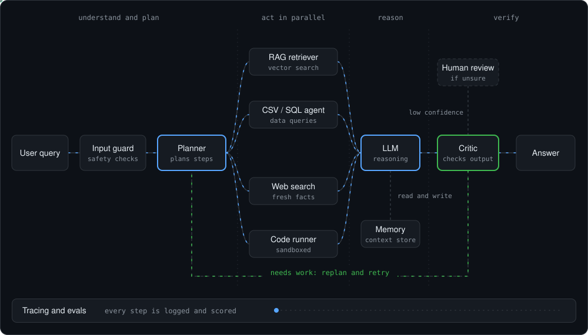

## About me

I'm Om Prakash, a developer focused on generative AI. I build RAG chatbots and LLM agents in Python, and I'm equally interested in backend development: the APIs and systems that make AI features work in real applications.

- 🔭 Currently building: **AI products and Scalabel backend for them**
- 🌱 Currently learning: **multi-agent workflows with LangGraph, FastAPI, Docker, Backend**
- 🎯 Looking for: **internships**
- 📍 Based in: **Jaipur**

## Tech stack

**Generative AI and agents** &nbsp; `Generative AI` `Agentic AI` `LangChain` `LangGraph` `RAG`

**Machine learning** &nbsp; `Python` `TensorFlow` `OpenCV` `Jupyter`

**Backend and tools** &nbsp; `FastAPI` `Docker` `Git` `GitHub`

## How my agents work

The general shape of the agents I build: check the input, plan, act with tools in parallel, reason with memory, then verify. The critic loops back to the planner until the answer passes, or hands over to a human when unsure.

## Stats

  
  

## Connect

